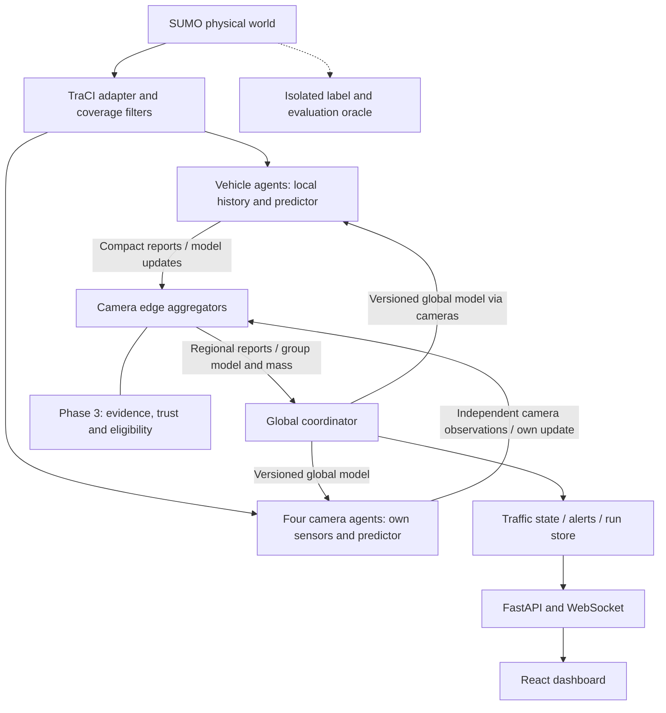

# System architecture

## Components and boundaries



One Python process initially owns simulation time, agents, messages and coordinator. “Edge” and “global” are logical roles on the same computer. Locality is enforced by interfaces and checked message contents, not claimed physical isolation. The web service reads snapshots/events; it does not own the simulation clock.

| Component | Owns | Must not do |
| --- | --- | --- |
| SUMO adapter | Start/step/close, vehicle lifecycle, bounded observations | Give arbitrary world queries to agents |
| Vehicle agent | Own sensor history, deterministic encoder, local predictor/update | Read other clients' private datasets |
| Camera sensor/client | Camera-only observations and own model training | Train on all relayed vehicle histories |
| Camera edge aggregator | Child routing, round membership, group aggregation, local trust evidence | Count a child's samples again as camera samples |
| Global coordinator | Global model version, group aggregation, state, trust registry and events | Train on pooled local histories during FL |
| Evaluator/label oracle | Full simulator truth, future labels, attack ground truth, metrics | Supply future/attack labels to live detectors or inference |
| Run store | Configs, events, predictions, weights and checkpoints | Mix raw agent logs into permitted upstream payloads |

## Camera ownership and mobility

Camera IDs: `cam_north`, `cam_south`, `cam_east`, `cam_west`. Map incoming edge IDs to these IDs in topology configuration. A vehicle attaches to the camera for its incoming approach at departure and retains that routing owner until arrival. Traversing internal/outgoing lanes does not create a new identity or camera reassignment. It stops producing approach-prediction windows when outside the input zone; lifecycle/heartbeat messages can continue.

This simple rule is sufficient for one intersection. A multi-intersection extension needs explicit handover and model/trust transfer; it is not silently added now. Camera sensing coverage is independent of its ownership list: it sees physical vehicles within its configured zone even if they are not learning participants.

## Hierarchy in each phase

Phase 1 routes compact observed summaries through the camera. It does not train models. Basic global state is a four-approach map of camera measurements plus identified child reports; it is not called a trusted consensus.

Phase 2 gives each camera two separate roles: independent learning client and edge aggregator. Both camera and vehicle clients train the same model architecture on their own samples. A camera's self-update participates exactly once in its group.

For global round r, use one common model theta_r and membership snapshot. Each eligible client i trains from theta_r and reports theta_i and n_i, the number of distinct training windows used (not epochs times rows). For camera group c:

```text
mass_c = sum(n_i for eligible clients in group c)
theta_c = sum(n_i * theta_i) / mass_c
theta_next = sum(mass_c * theta_c) / sum(mass_c)
```

Include camera self-training in those sums. Do not average the four camera models equally. The initial HFL implementation has one local epoch and one edge aggregation per global round. On identical updates and clients, it is mathematically equivalent to flat FedAvg, apart from numerical rounding. Thus the initial hierarchy demonstrates organization and communication structure; do not promise extra accuracy from grouping alone. Multiple edge-local cycles/personalization are optional later experiments.

## Round protocol and failures

1. Coordinator freezes round ID, model/schema hash, membership and participant eligibility.
2. Cameras relay the model; each client uses its local training partition only.
3. Edge accepts one compatible update per client/round before the deadline; checks tensor shapes, finiteness and sample accounting.
4. In Phase 3 evaluate candidate evidence and obtain a frozen per-client trust/eligibility weight before group aggregation.
5. Edge sends group model, effective mass and accepted-client provenance; coordinator verifies groups do not overlap.
6. Coordinator publishes a new version only when total accepted mass is positive. Otherwise retain the prior model and log a skipped round.
7. Deliver the new version via cameras. New clients start from the latest committed model at the next round boundary.

Default online demonstration: reports each simulation second; attempted learning/trust rounds each 30 simulated seconds. Training may pause simulation in the first implementation. Measure simulated time and wall-clock cost separately; a paused simulator is not evidence of real-time performance. Round deadlines are explicit configuration; late updates are dropped rather than mixed into a newer base model.

No eligible client in a group means omit that group's update, not a zero model. Disconnected clients retain their local data and reputation but do not contribute unavailable updates. A malformed update is rejected and logged. Its sender is not automatically labelled malicious.

## Short-lived vehicles and datasets

Offline benchmark: each saved vehicle trajectory is a separate local client dataset and is routed through its original camera group. Those datasets can participate in several training rounds as explicitly simulated replay clients; this is not a claim that vehicles stayed at the intersection. Camera datasets contain only their own sensor records. Report counts and sizes by agent type.

Online demonstration: vehicle clients require 10 observations plus a matured future label and at least 16 valid training windows to train. Otherwise they perform inference only. The isolated simulation label service releases labels to client-local storage only after their horizon has elapsed; this is a simulator supervision assumption, not an on-road deployment solution. Departed vehicles do not send new live updates. New identities receive no inherited vehicle data; existing identities never reset trust upon reconnection.

Persistent cameras provide continuity but cannot be used to claim active vehicle federation when all vehicles are ineligible. Increase approach residence/data collection or use the declared replay benchmark when necessary.

## Phase 3 trust placement

Assume the simulator, global coordinator and camera routing/aggregation code execute correctly. Core attacks compromise selected vehicle reports/updates or a camera's sensing/self-training output, not its aggregator code. A fully malicious edge that fabricates sums or drops arbitrary children is outside the core threat model and must be declared as such.

Camera edges inspect individual candidate updates against a versioned, clean calibration dataset from separate simulator runs. Evidence and provenance reach the global trust registry; raw update inspection stays at the relevant edge. After the trust registry returns the frozen weights, edges aggregate with effective mass `n_i * T_i^2 * eligibility_i`. The global level weights by the sum of those same effective masses. Do not apply a second camera trust factor to all descendants. The camera's own learner has its own trust; its children's trust remains individual.

## Storage and proposed layout

```text
src/trafma/
  simulation/       SUMO lifecycle, topology, observation adapter, label oracle
  agents/           registry, vehicle client, camera client and group ownership
  communication/    typed messages, simulated bus, delivery and deduplication
  features/         versioned encoders, normalization and datasets
  models/           GRU, losses, local training and inference
  federated/        round protocol, flat/edge/global aggregation, checkpoints
  trust/            relevance, evidence, scoring, lifecycle and audit trail
  attacks/          semantic/update hooks and schedules
  consensus/        coverage-aware regional fusion and incident logic
  evaluation/       baselines, metrics, experiment runner and report export
  storage/          run manifests, local records, events and snapshots
  api/              FastAPI snapshot/event/replay interfaces
frontend/           React dashboard
configs/            topology, demand, data, learning, trust and attack settings
sumo/               source network/routes/signal configuration
tests/              unit, integration and reproducibility fixtures
runs/<run-id>/      immutable resolved config, versions, events, metrics, plots
```

These implementation folders are a plan; do not create empty modules to imply progress. Initially use JSONL events and per-agent CSV/Parquet as needed. SQLite may serve indexed dashboard/history reads in Phase 3. No external broker or database service is needed for the core local system.

## Technical grounding

TraCI supports external simulation control and retrieving vehicle state through Python. Confirm installed-version behavior during setup using [SUMO TraCI documentation](https://sumo.dlr.de/docs/TraCI.html) and [vehicle variables/units](https://sumo.dlr.de/docs/TraCI/Vehicle_Value_Retrieval.html). Sample-weighted model averaging follows the [original FedAvg paper](https://proceedings.mlr.press/v54/mcmahan17a.html); the two-level mass-preserving construction above is this project's design choice.
