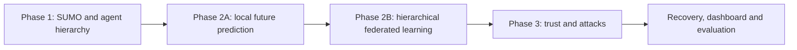

# TRAF-MA: three-phase implementation plan

## How to use this plan

Work in milestone order. For each milestone: read its contracts, implement the smallest working slice, run its checks, save evidence, then update [STATUS](STATUS.md). Never mark a phase complete solely because all its modules exist.

The first phase is fixed by the latest request. The other two phases place local prediction before hierarchical FL, and defer trust/attacks until the simulation and learning baseline work. Literature and architecture begin now and are updated through all phases.



Phase 2A/2B are milestones inside Phase 2, not extra phases.

## Phase 1 - Stable simulation and agent hierarchy

**Demo story:** “I can run one intersection with four camera agents and N vehicle agents, inspect each agent's local view, and trace vehicle updates through cameras to the global coordinator.”

| Milestone | What to build, in order | Completion evidence |
| --- | --- | --- |
| P1.1 Environment and project skeleton | Check Python/SUMO, install missing simulator as needed, pin working dependencies; create package/config/test skeleton; add environment diagnostic command | Python can start/close a minimal SUMO process; versions and setup instructions recorded |
| P1.2 Intersection | Four incoming/outgoing approaches, one signalised junction, explicit connections/routes and fixed safe signal schedule; headless and GUI modes | All four approaches used; routes valid; no unexplained collisions/teleports; generated files saved |
| P1.3 Reproducible traffic | Seeded departure schedule, N parameter, balanced and asymmetric demand; expose duration and step size | Same seed/config reproduces route/departure trace; different N changes scheduled population; invalid N rejected |
| P1.4 Agent registry and observation boundary | Four fixed cameras; create vehicles on departure and retire on arrival; map incoming road to parent camera; bounded local sensors | Scope fixtures show camera cannot observe another approach and vehicle cannot read entire world; zero-vehicle run works |
| P1.5 Messages and coordinator | Typed observation summaries, schema/version/time/provenance; local camera relay; global per-approach state; deduplication | Vehicle → camera → coordinator path demonstrated; duplicates and stale reports rejected; camera evidence distinguished from relayed child evidence |
| P1.6 Local logs and demonstration | Agent-local records, run manifest, traffic snapshot, message trace and summary; basic SUMO GUI plus console summary | Saved clean demonstration, deterministic replay data and phase-gate checklist |

**Default starting configuration, to be measured:** one lane per direction on each arm; 300 m arms; 150 m camera/target zone before each stop line; 100 m vehicle observation radius constrained to its incoming approach; 1 s simulation/report step; N=20; 600 s run; seed=42. Use straight movements first; add left/right routes within P1.2 once signal connections are verified. These are editable defaults, not research findings or fixed N limits.

**N edge cases:** test N=0, N=1, N=20 and N=100. Vehicles delayed by insertion constraints remain pending; do not create an active agent before SUMO reports departure. At timeout record pending/unfinished vehicles rather than claiming all N completed.

**Phase 1 gate (all required):**

- [ ] GUI and headless runs finish or report a defined timeout and close TraCI cleanly.
- [ ] Four cameras exist throughout; vehicle registry matches departed/active/arrived events.
- [ ] Ownership persists through the junction until arrival; out-of-coverage observations are masked/omitted.
- [ ] Identical seed, configuration and simulator version reproduce non-wall-clock trace fields.
- [ ] Every vehicle message reaches the coordinator through its parent; no duplicate counted contribution.
- [ ] Locality, empty regions, missing values, stale messages and malformed configuration have checks.
- [ ] Manifest, per-agent logs, message trace and global snapshot are saved for each run.

**Do not add yet:** model training, federated rounds, trust scores, malicious traffic reports or the full web dashboard. Reserved message fields may exist with explicit “unavailable” values.

**Recovery if blocked:** if SUMO cannot launch, fix the environment diagnostic first. If routes fail, reduce to straight traffic. If locality/routing fails, fix agent boundaries before collecting training data. Preserve failing seeds as regression scenarios.

## Phase 2 - Local prediction, then hierarchical federated learning

**Demo story:** “Each agent predicts congestion and queue length 30 seconds ahead from its limited history; shared model learning improves or changes those predictions without pooling client histories in the live coordinator.”

Read [data contracts](DATA_CONTRACTS.md) and [architecture](ARCHITECTURE.md) before starting.

| Milestone | What to build, in order | Completion evidence |
| --- | --- | --- |
| P2.1 Data generation and labels | Generate free/moderate/heavy/asymmetric demand runs; store bounded local observations; evaluator generates future approach labels; freeze schema and split manifest | Coverage audit, valid future alignment, per-client label histograms and no train/test overlap |
| P2.2 Baselines | Last-observation persistence, majority-class diagnostic, independent local model and pooled offline central reference | Common held-out evaluation rows and metric report; missing observation policy recorded |
| P2.3 Local predictor | Deterministic vehicle/camera adapters → common 22-value input → GRU with congestion and queue heads; normalized targets and masks | Correct shapes, finite losses, tiny-data overfit sanity check, then held-out per-approach/type results |
| P2.4 Flat FedAvg reference | Identical global initialization; local train/update; sample-count weighted global model; versioned checkpoints | Hand-computed weighted-average fixture, dropped/empty client checks; local histories never enter live coordinator |
| P2.5 Hierarchical FedAvg | Vehicles train locally; each camera also has its own independent client model; camera aggregates eligible child/self updates; coordinator aggregates group models | Group-mass weighting equals flat FedAvg on a fixed fixture; no equal weighting of unequal groups or double-counted camera descendants |
| P2.6 Non-IID and transient participation | Approach/demand/type/coverage skew, train/test clients, minimum history rule, round ownership snapshot, late arrivals/departures | Replay benchmark plus online participation demonstration; counts of trained/skipped/disconnected clients |
| P2.7 Evaluate and freeze baseline | Compare local, central, IID flat FL, non-IID flat FL and hierarchical FL with matched budgets | Baseline checkpoints, curves, bytes/time logs and an honest interpretation of results |

**Starting model defaults:** sample every 1 s; 10 observations per history; horizon 30 s; GRU hidden size 32; shared dense layer 16; three-class congestion head and nonnegative queue head; Adam learning rate 0.001; batch size 16; one local epoch; 20 federated rounds for the first benchmark. Loss = cross-entropy + MSE on queue normalized by approach capacity. These are versioned experimental defaults, tuned on validation data only.

**Do not confuse online demonstration with training evaluation:** short-lived vehicles may never collect enough history plus future labels in one traversal. First use saved, agent-local trajectory clients for repeatable offline learning. Require at least 16 valid windows for training; otherwise inference only. At least two cameras and multiple vehicle clients must contribute to the HFL acceptance demo; report when a dataset cannot provide this. Then demonstrate online warm starts and sparse participation without pretending departed clients are still connected. See [architecture](ARCHITECTURE.md).

**Phase 2 gate (all required):**

- [ ] Feature schema, normalizers, queue definition, congestion rule, horizon and split manifest are versioned.
- [ ] Future labels and evaluator truth never enter inference features; windows do not cross a split/run boundary.
- [ ] All federated tensors share names, dimensions and semantic meaning.
- [ ] Persistence, local-only, central reference, flat FL and HFL results use the same held-out scenarios where applicable.
- [ ] Hierarchical aggregation matches flat weighted averaging on identical updates within numeric tolerance.
- [ ] Empty groups, late/duplicate/incompatible updates, insufficient history and reconnects have defined behavior.
- [ ] Non-IID skew is measured, not just asserted; held-out results are saved with seeds and uncertainty.
- [ ] Any failure to beat persistence is explained and investigated before adding security complexity. Do not hide it or invent a pass margin.

**Recovery if blocked:** fix label alignment/leakage before model tuning. Use a small fixture to debug aggregation. If vehicles lack samples, increase data-generation duration/demand or use honest offline replay clients; never stitch unrelated identities together. Do not add trust to compensate for a broken clean baseline.

## Phase 3 - Trust, security and complete system

**Demo story:** “Some agents send false traffic information or poisoned model updates. The system records the evidence, reduces their influence, quarantines persistent offenders, continues monitoring them, and restores influence gradually after clean behavior resumes. Honest differing views and real traffic incidents are handled separately.”

Read [trust methodology](TRUST_AND_SECURITY.md), [evaluation](EVALUATION.md) and [dashboard design](DESIGN_SYSTEM.md).

| Milestone | What to build, in order | Completion evidence |
| --- | --- | --- |
| P3.1 Threat model and attack harness | Freeze trust boundaries; add semantic falsification and outgoing-update poisoning hooks; independent evaluator attack labels | Attack changes only its declared channel; immutable truth and seeded schedules preserved |
| P3.2 Evidence and trust | Contextual overlap, physical plausibility, temporal behavior, model validation and delivery evidence; availability-aware reliability and EMA | Per-factor audit trail; no-peer/real-incident/non-IID controls; no use of attack labels |
| P3.3 Trust in HFL and consensus | Snapshot trust for each round; inspect candidate updates at camera edge; sample × trust weighting at both levels; regional semantic fusion | Effective client weights reconstructed; no trust squared twice across levels; zero-mass fallback |
| P3.4 Quarantine and recovery | Persistent-evidence state machine, zero influence during quarantine, shadow validation, guarded recovery and relapse | Full lifecycle trace with explicit transition reasons and observed recovery delay |
| P3.5 Alerts and dashboard | Separate agent anomaly/incident streams; FastAPI snapshots/WebSocket; React four-approach map, predictions, trust and events; replay | Dashboard survives disconnect/reconnect, marks stale data, and never presents unknown values as zero |
| P3.6 Controlled experiments | Paired clean/attack runs; unprotected vs defended HFL; honest disagreement, real incidents, recovery, ablations and cost | Per-run metrics, seed summaries, confusion matrices, trust/weight curves, limitations |
| P3.7 Final end-to-end delivery | Saved demo schedule, reproduction guide, report/diagram alignment and literature claim audit | Clean → false report → recovery → poisoning → recovery replay plus clean incident/disagreement examples |

**Phase 3 gate (all required):**

- [ ] Both attack classes run independently and together without evaluator-label leakage.
- [ ] Quarantined clients have zero model and consensus influence but can provide bounded shadow evidence.
- [ ] Legitimate disagreement and poor connectivity are evaluated separately from malicious behavior.
- [ ] Trust scoring cannot compare non-overlapping regions or different forecast horizons as identical reports.
- [ ] Recovery requires sustained clean evidence; identity churn does not reset reputation inside a run.
- [ ] Dashboard shows observed/predicted/trusted states distinctly, along with coverage, timestamp and model version.
- [ ] Paired results include false alarms, false quarantine, detection latency, prediction error, attacker influence, recovery and overhead.
- [ ] Run artifacts reproduce the tables/plots; unsupported novelty, privacy and robustness claims are removed.

## Time and effort guide

Planning estimates, not deadlines: Phase 1 about 5–8 focused workdays; Phase 2 about 10–15; Phase 3 about 15–22. Allow another 20–30% for integration, compute constraints and report revision. Parallel team work can shorten elapsed time only after shared contracts are stable. The workday ranges do not imply that all team members work full time.

If maintaining the earlier semester structure: odd semester = literature/architecture plus Phases 1–2; even semester = Phase 3 and final evaluation. The current three-phase build sequence governs implementation.

## Intended command interface (not implemented yet)

```powershell
python -m trafma doctor
python -m trafma simulate --config configs/phase1.yaml --vehicles 20 --seed 42 --gui
python -m trafma collect --config configs/data.yaml
python -m trafma train --mode local --config configs/learning.yaml
python -m trafma train --mode hierarchical --config configs/learning.yaml
python -m trafma experiment --config configs/security.yaml
python -m trafma replay --run runs/<run-id>
python -m pytest
```

Implement and verify each command only in its milestone. Maintain an exact tested Windows setup/run guide at P1.1 and extend it with each phase.

## Change and stopping rules

Keep only the current milestone in progress. A failed gate becomes the next task. If research results disappoint, retain the result and adjust documented hypotheses/parameters using validation data; never tune on the test set. Optional extensions require the core end-to-end system to remain reproducible. See [decisions](DECISIONS.md) for choices that may evolve.
